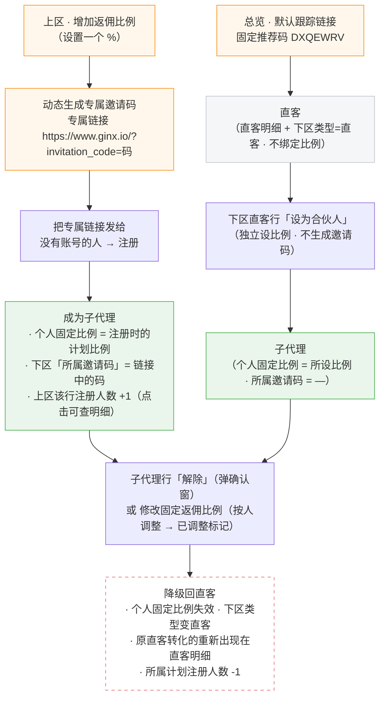

# PRD · 合伙计划与直客功能逻辑说明

> Gin Partner 控制台静态原型。本文覆盖合伙计划全链路：总览入口、直客明细、合伙人列表（一页两区）、弹窗与抽屉。数据均为内存态（刷新后恢复 mock 初始值：分佣比例 6 条 / 子代理 26 条 / 直客 12 条）。
> 第 1 节内嵌 Mermaid 流程图（GitHub / VS Code / Typora 等 Markdown 预览可直接渲染）。

---

## 1. 全局逻辑（身份模型）

> **一句话**：合伙人列表页按「计划」和「人」两个维度组织——上区管分佣比例（比例 → 专属邀请码 → 链接），下区管人（直客 / 子代理）。子代理 = 绑定了固定分佣比例的人。

### 1.1 人的两种来路（核心）

**① 默认跟踪链接 → 直客 →（可选）后期转化**
（固定推荐码，人先注册、比例后补）

```
总览「默认跟踪链接」（固定推荐码 DXQEWRV）
   → 任何人经此注册 = 直客（系统默认等级，不绑定任何比例）
     · 见直客明细页，也在合伙人列表下区（类型=直客）
   → 后期想给 TA 固定比例：下区直客行「设为合伙人」独立设比例
     （不生成邀请码、不关联已有分佣比例，保存即成子代理）
   → 解除 → 降回直客
```

**② 设置分佣比例 → 动态邀请码 → 注册即绑定**
（每设一个 % 动态生成一个码，比例先行、人后进）

```
上区「增加返佣比例」（设一个 %）
   → 系统动态生成本比例专属邀请码（一比例一码：20%→123，3%→444）
   → 专属邀请链接 = https://www.ginx.io/?invitation_code=码，发给没有账号的人
   → 对方注册即在注册那一刻复制该比例作为个人固定比例，成为子代理：
     · 下区类型 = 子代理，所属邀请码 = 注册所用链接中的码
     · 上区该行「注册人数」+1，点数字可看这些人
   → 解除 → 降回直客（人数随之 -1）
```

### 1.2 两层比例规则（关键）

| 层 | 规则 |
| --- | --- |
| 计划比例（上区） | 分佣比例**创建后不可修改**（无编辑入口）；个人比例在链接注册那一刻复制创建时的计划比例 |
| 个人固定比例（人） | 链接注册 = 注册时复制计划比例；直客转化 = 设置时填写的独立比例。之后只能经子代理行「修改固定返佣比例」按人改，改过的显示「已调整」标记 |

其余关键概念：

| 概念 | 规则 |
| --- | --- |
| 两种码 | **推荐码**：固定、全局一条（DXQEWRV），只产生直客；**邀请码**：动态、一比例一个，注册即绑定该比例 |
| 一次降级 | 「解除」后效果一致：个人固定比例失效 · 回原本等级（无则系统默认）· 下区类型变回直客；原直客转化的会重新出现在直客明细 |
| 人数口径 | 上区「注册人数」= **当前绑定**人数（解除即减员），非历史注册数 |

### 1.3 流程图



### 1.4 链接 / 邀请码在哪里展示什么（多比例并存时的口径）

| 位置 | 展示内容 |
| --- | --- |
| 添加成功弹窗 | 只展示**刚保存的那一个比例**的专属链接（基础地址 + 该邀请码）；设 20% 出 `?invitation_code=123`，设 30% 出 `?invitation_code=22`，每次保存只出自己那条 |
| 总览 · 默认跟踪链接卡 | 永远只显示默认链接（固定推荐码 DXQEWRV），与任何邀请码无关 |
| 上区「分佣比例」· 邀请码列 | **全量总览**：每个比例一行、各显示各的码；**点击码即复制该比例完整专属链接**（1.2s 变绿「已复制」），随时可找回任意链接 |

> 链接基础地址统一为 `https://www.ginx.io/?invitation_code=<码>`（与线上域名同体系）。

---

## 2. 页面：工作台总览（#/overview）

**默认跟踪链接卡**（橙红描边）

| 元素 | 说明 |
| --- | --- |
| 卡标题「默认跟踪链接」 | 旁有 `生效中` 绿徽章、**分享图标按钮**（跳转合伙人列表页，分佣比例在页内上区创建） |
| 推荐码 DXQEWRV | 默认链接的推荐码；经此链接注册的用户为**直客**，不绑定任何计划 |
| Web地址 / Miniapp地址 | 复制图标**仅复制地址**，不弹窗、不建计划；合伙计划的专属链接在保存成功后的完成态中展示与复制 |
| 二维码按钮 | 占位 |

---

## 3. 页面：直客明细（#/direct-customers）

通过默认跟踪链接注册的客户列表（保持线上现状，无操作列、无多选框）。

**表格字段**

| 字段 | 意思 |
| --- | --- |
| 用户UID / 用户昵称 / 用户名 | 注册账号信息 |
| 注册时间 | 经默认链接注册的时间 |
| 累计交易量(USDT) / 累计返佣(USDT) | 该客户贡献的交易与返佣 |
| 状态 | 活跃（绿）/ 静默（灰） |

**与其他页的关系**：本页直客与合伙人列表下区同源（同 UID）；直客在下区被「设为合伙人」后自动从本页隐藏，解除后自动恢复（convertedUids 机制）。转化入口在下区，不在本页。

---

## 4. 页面：合伙人列表（#/partner-list，一页两区）

页头：标题 + 导出（右上角）。正文上下两个卡片。

### 4.1 上区：分佣比例（计划维度）

头部右侧：搜索框（对 计划名称 / 合约分佣比例 / 邀请码 做模糊匹配，输入即过滤、带 ✕ 清除，比例兼容带 % 输入）+「增加返佣比例」（橙色主按钮）→ 弹窗 A；保存后进「添加成功」完成态（弹窗 B），新比例插入列表第一页顶部、注册人数 0。底部为 5 条/页分页；**无操作列**（比例创建后不可修改）。

**表格字段**

| 字段 | 意思 |
| --- | --- |
| 计划名称 | 备注名，用于识别 |
| 邀请码 | 本比例专属邀请码；**点击复制该比例完整专属链接**（1.2s 变绿「已复制」） |
| 合约分佣比例 | 百分比数字（88 = 88%） |
| 有效期 | 时间限制日期，留空显示「永久」 |
| 注册人数 | 经该链接注册且当前绑定的客户数（**当前绑定口径**）；橙色下划线可点击 → 打开抽屉（4.3） |

### 4.2 下区：直客与子代理（人员维度）

**标题行右侧**：人员类型下拉（全部 / 直客 / 子代理，切换即时生效）+ 单个搜索框（对 UID / 用户昵称做模糊匹配，输入即过滤，带 ✕ 清除），与上区头部布局同款。

**表格字段**

| 字段 | 意思 |
| --- | --- |
| 用户UID / 用户昵称 / 注册时间 / 累计交易量 / 累计返佣 | 同直客明细口径（无用户名列） |
| 人员类型 | 徽章：直客（灰）/ 子代理（橙） |
| 当前生效比例 | 子代理显示个人固定比例（被单独改过的带「已调整」标记）；直客显示 — |
| 所属邀请码 | 链接注册的显示所属邀请码；直客转化的显示 — |
| 操作（最末列） | 直客行：**设为合伙人**（弹窗 C）；子代理行：**修改比例**（弹窗 D）+ **解除**（弹窗 E） |

### 4.3 抽屉：注册客户明细（点注册人数打开）

右侧滑出（760px），标题「邀请码 xxx · 注册客户 N 人」+ 摘要行（计划名 · 比例 · 有效期）。

- **汇总条**（4 项）：注册人数 · 活跃客户 · 累计交易量(USDT) · 累计返佣(USDT)（按成员求和）
- **表格**：UID / 昵称 / 注册时间 / 状态（活跃绿·静默灰）/ 累计交易量 / 累计返佣 / 当前生效比例（含「已调整」标记）；无用户名列
- 搜索（UID / 昵称）+ 分页（10 条/页）；Esc / 遮罩 / ✕ 关闭
- 只显示当前绑定成员；在下区解除某人后，此处人数与列表联动减员

---

## 5. 弹窗 A：添加分佣比例（上区）

标题：添加分佣比例。

**字段**

| 字段 | 必填 | 意思与规则 |
| --- | --- | --- |
| 合伙计划名称* | 是 | 备注名 |
| 合约分佣比例* | 是 | **按百分比直接填数字**（88 = 88%）；失焦即四舍五入展示（22.22→22、23.99→24）；逗号兼容小数点；范围 0~100，超范围/非法输入保存时红字报错 |
| 时间限制（留空为永久） | 否 | 日期控件；不填 = 永久生效 |
| 邀请码（自动生成） | — | 本比例专属码（4 位随机），只读 |
| 更多分佣比例（折叠区，7 项） | 否 | 合约交易员 / 合约api / 合约交易员api、币币 / 币币交易员 / 币币api / 币币交易员api；默认**收起**，展开后顶部橙色提示条「当前暂不生效，仅作保存记录」；隐藏区有校验错误时保存自动展开 |

**通用交互**：必填以标签后红星标识；比例框右侧灰色 % 单位；Esc / 遮罩 / ✕ / 取消 关闭；Enter 或「保存」提交。

## 6. 弹窗 B：添加成功（仅新建路径）

保存成功后进入完成态（居中布局、绿色对勾弹入动画）：

- 摘要：「XX」已保存为分佣比例 · 合约分佣比例 N% · 有效期 永久/日期 · 邀请码 xxxx
- **专属邀请链接**（`https://www.ginx.io/?invitation_code=xxxx`）+ 复制按钮（1.5s 变「已复制」）
- 说明：每个分佣比例生成一条专属邀请链接（含本邀请码），发给谁、谁注册后即绑定此比例，按已设比例结算
- 「完成」关闭


## 7. 弹窗 C：设为合伙人（下区直客行）

小弹窗：橙色提示条（独立设比例，不生成邀请码、不关联已有分佣比例，保存后即成为子代理）+ 用户昵称（只读，预填）+ 合约分佣比例*（% 输入）。保存后该行类型变子代理、显示所设比例、所属邀请码 —；同 UID 自动从直客明细隐藏。

## 8. 弹窗 D：修改固定返佣比例（下区子代理行）

小弹窗：橙色提示条（修改仅对该成员本人生效）+ 当前生效比例（只读，如 93%）+ 新的合约分佣比例*。保存后比例更新并带「已调整」标记（rateOverridden）。

## 9. 弹窗 E：解除固定分佣（确认窗）

| 元素 | 内容 |
| --- | --- |
| 标题 | 解除固定分佣 |
| 正文 | 解除后，「XX」将不再享有当前设置的固定合约分佣比例，等级降回其原本等级；若原本没有等级，则回到系统默认等级。该成员将在下方列表中降回「直客」。确定要解除吗？ |
| 按钮 | 取消（关闭不执行）/ 确定（执行解除） |

确定后：下区该行类型变直客（比例/邀请码清空）；原直客转化的重新出现在直客明细；若为链接注册，上区所属比例注册人数 -1。

---

## 10. 边界汇总

| 边界 | 规则 |
| --- | --- |
| 链接模型 | 每个分佣比例一条专属链接（基础地址 + 本邀请码）；总览「默认跟踪链接」注册的只是直客，不绑定任何比例 |
| 两层比例 | 分佣比例创建后不可修改；个人比例注册/转化时锁定，按人改走「修改固定返佣比例」 |
| 人数口径 | 注册人数 = 当前绑定；解除即减员 |
| 直客明细联动 | 同源数据（同 UID）：转化隐藏 / 解除恢复；该页本身无操作列 |
| 比例口径 | 全链路百分比整数（输入可带小数/逗号，归一后四舍五入） |
| 折叠区 7 项比例 | 当前不生效，仅保存记录 |
| 时间限制 | 留空 = 永久 |
| 数据 | 内存态，刷新恢复初始 mock（分佣比例 6 / 子代理 26 / 直客 12，注册人数动态计算） |
